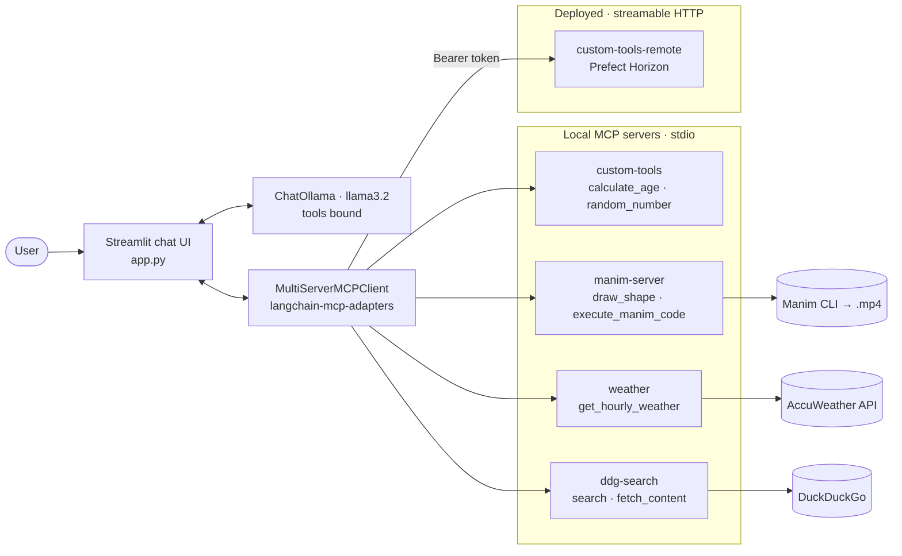
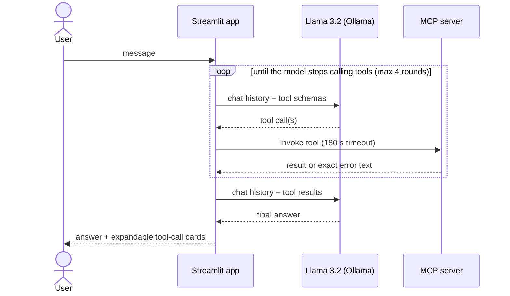
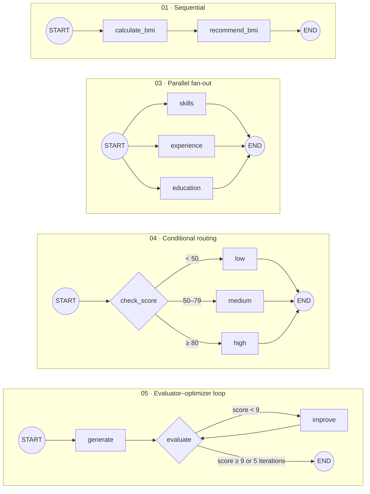
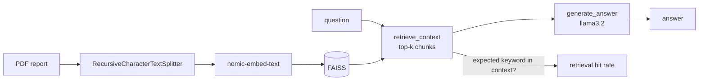
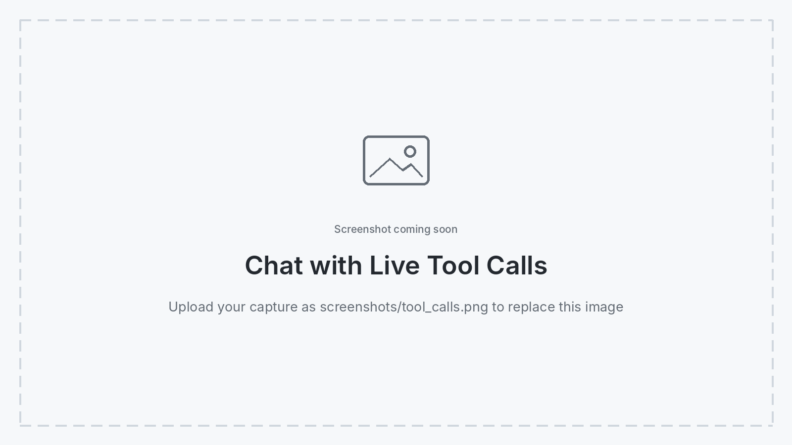
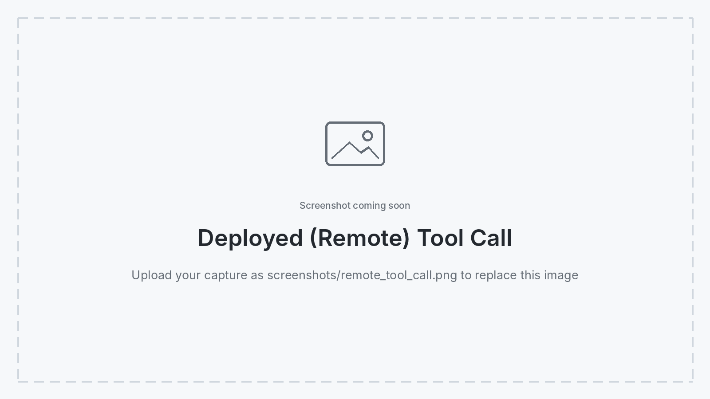

# 🤖 Agentic AI Lab: LangGraph Workflows & Multi-Server MCP Client


A hands-on collection of agentic AI building blocks that runs entirely on a **local LLM**: eight LangGraph workflows — from a two-node graph up to RAG with a retrieval benchmark and Postgres-backed long-term memory — and six Model Context Protocol (MCP) tasks that end in a **Streamlit chat client orchestrating five MCP servers at once**, four local and one deployed to the cloud.

<p align="center">
  
</p>
<p align="center"><em>The MCP client: a local Llama 3.2 model with tools from five MCP servers, listed in the sidebar.</em></p>

## 👨‍💻 Author

**Ahsan Rizvi**

## 📌 What This Project Covers

| Track | What's inside | Highlights |
|---|---|---|
| **[LangGraph workflows](langgraph_tasks)** | 8 standalone graphs | Sequential, parallel fan-out, conditional routing, evaluator–optimizer loop, ReAct tool agent, short- + long-term memory, RAG with retrieval evaluation |
| **[MCP servers & client](mcp_tasks)** | 6 tasks | Custom FastMCP server, hardened Manim animation server, fixed AccuWeather server, DuckDuckGo search, remote deployment on Prefect Horizon, and a Streamlit client that ties them all together |

Everything runs against **Llama 3.2 through Ollama** — no paid LLM API is required.

## 🏗️ System Architecture

The Streamlit client binds every MCP tool to a local Llama 3.2 model and lets the model choose which server to call:



Each message runs a bounded tool-calling loop:



## 🧠 Track 1 — LangGraph Workflows

| # | Task | Pattern | What it demonstrates |
|---|---|---|---|
| 01 | BMI calculator | Sequential | Typed `StateGraph` state passed between two nodes |
| 02 | Ollama Q&A | Single LLM node | Wrapping `ChatOllama` in a graph |
| 03 | Résumé analyzer | Parallel fan-out / fan-in | Three analyzers run in the same super-step and merge into one state |
| 04 | Student score router | Conditional edges | `add_conditional_edges` sending state to one of three branches |
| 05 | Iterative answer improvement | Evaluator–optimizer loop | LLM-as-judge scores the answer 1–10 and the graph rewrites it until the score is ≥ 9 or 5 iterations pass |
| 06 | Tool-calling chatbot | ReAct agent | `ToolNode` + `tools_condition` with Wikipedia, YouTube, Stack Exchange, a custom age tool and a live Open-Meteo weather tool |
| 07 | Long-term memory | Memory | `InMemorySaver` for the current thread + `PostgresStore` for facts about the user that survive restarts |
| 08 | Local RAG | Retrieval + benchmark | FAISS + `nomic-embed-text`, scored across three chunking / top-k configurations |

The four core control-flow patterns:



### Long-term memory (task 07)

Before every reply, a `remember` node asks the model whether the user's message contains a new fact worth keeping (name, preference, project…). New facts are written to **PostgreSQL** through LangGraph's `PostgresStore` under a per-user namespace, and the `chat` node injects everything known about the user into the system prompt. Restart the script and the bot still remembers you.

### RAG with retrieval evaluation (task 08)



Rather than eyeballing answers, the script measures **retrieval quality**: each of eight test questions has an expected keyword (e.g. *"What is the main control chip?"* → `STM32`), and a question counts as a hit when that keyword appears in the retrieved context. The same pipeline is scored under three configurations:

| Config | Chunk size | Overlap | Top-k |
|---|---|---|---|
| Small | 250 | 50 | 2 |
| Medium | 500 | 100 | 3 |
| Large | 1000 | 200 | 5 |

## 🔌 Track 2 — MCP Servers & Client

| Task | Server | Transport | Origin | Key work |
|---|---|---|---|---|
| [01](mcp_tasks/task_01_custom_tools_server) | Custom tools | stdio | Built from scratch | FastMCP 4.x server with `calculate_age` and `random_number`, verified in the MCP Inspector |
| [02](mcp_tasks/task_02_manim_mcp_server) | Manim animations | stdio | Adapted + hardened | Server-side code generation for small models, path-restricted cleanup, render timeout |
| [03](mcp_tasks/task_03_weather_mcp_server) | AccuWeather | stdio | Adapted + fixed | Bearer-auth migration, cache `NameError` fix, HTTPS |
| [04](mcp_tasks/task_04_duckduckgo_mcp_server) | DuckDuckGo search | stdio (`npx`) | Third-party | Key-free web search with no Python dependency conflicts |
| [05](mcp_tasks/task_05_deploy_horizon) | Custom tools (remote) | streamable HTTP | Deployed | Hosted on Prefect Horizon, reachable from Claude Desktop and the Streamlit client |
| [06](mcp_tasks/task_06_streamlit_mcp_client) | **Streamlit client** | — | Built from scratch | Multi-server orchestration with a local LLM |

### 🛠️ Engineering highlights

**Making a third-party server safe and small-model friendly (task 02).** The upstream Manim server expected the model to write complete Manim scripts and would delete *any* directory path passed to its cleanup tool. The reworked version:
- adds a `draw_shape` tool where the **server** writes the Manim code from whitelisted options, so a 3B-parameter model only picks a shape, colour and animation — and tool arguments can never inject Python;
- confines `cleanup_manim_temp_dir` to the server's own `media/` folder;
- adds a 150 s render timeout and closes `stdin` so a render can never hang the agent;
- strips Markdown code fences, adds missing `from manim import *`, and keeps all logging on stderr so it never corrupts the stdio protocol stream.

<p align="center">
  
</p>
<p align="center"><em>Rendered end-to-end from the prompt "create a simple animation of a circle turning into a square".</em></p>

**Fixing a broken integration (task 03).** The AccuWeather server stopped working after AccuWeather retired query-string API keys. It now authenticates with a Bearer header, and a cache bug that crashed every repeated lookup for the same city is fixed.

**Resolving dependency conflicts.** FastMCP 4.x requires `mcp>=2`, while the Manim server and `langchain-mcp-adapters` need `mcp<2`. The Manim server therefore runs from its own virtual environment, and the Streamlit client talks to the remote server with a Bearer token, so it never needs FastMCP installed.

**A resilient multi-server client (task 06).** Server definitions are validated before connecting, each server loads with its own timeout, duplicate tool names are namespaced (`remote_` prefix for the deployed server), tool rounds and tool calls are bounded, and every call is rendered as a card with its arguments, output and status.

<p align="center">
  
</p>
<p align="center"><em>Tool calls are shown inline with their arguments and raw output.</em></p>

<p align="center">
  
</p>
<p align="center"><em>A <code>remote_</code> tool answered by the server deployed on Prefect Horizon.</em></p>

## 🚀 Setup

### Prerequisites

| Requirement | Used by |
|---|---|
| Python 3.13 | Everything |
| [Ollama](https://ollama.com/) with `llama3.2` (and `nomic-embed-text` for RAG) | LangGraph tasks 02, 05–08 and the MCP client |
| PostgreSQL | LangGraph task 07 |
| Node.js 18+ | DuckDuckGo server (task 04) |
| AccuWeather API key | Weather server (task 03) |
| Prefect Horizon token | Remote server (task 05) — optional |

```bash
git clone https://github.com/ahsanrizviii/agentic-ai-langgraph-mcp.git
cd agentic-ai-langgraph-mcp

ollama pull llama3.2
ollama pull nomic-embed-text
```

### LangGraph workflows

```bash
python -m venv venv
venv\Scripts\Activate.ps1          # macOS/Linux: source venv/bin/activate
pip install -r requirements.txt

python langgraph_tasks/task_01_bmi_calculator_langgraph.py
```

See [`langgraph_tasks/README.md`](langgraph_tasks/README.md) for the PostgreSQL and PDF setup used by tasks 07 and 08.

### MCP servers and client

Set up the servers first (each folder has its own README), then the client. On Windows PowerShell:

```powershell
# Tasks 01 + 03 — global Python (FastMCP 4.x)
pip install -r mcp_tasks\task_01_custom_tools_server\requirements.txt
pip install -e mcp_tasks\task_03_weather_mcp_server

# Task 02 — Manim server in its own venv (needs mcp<2)
cd mcp_tasks\task_02_manim_mcp_server
python -m venv .venv
.\.venv\Scripts\pip install -r requirements.txt
cd ..\task_06_streamlit_mcp_client

# Task 06 — the client, in its own venv (also needs mcp<2)
python -m venv .venv
.\.venv\Scripts\pip install -r requirements.txt
Copy-Item .env.example .env        # add ACCUWEATHER_API_KEY, FASTMCP_TOKEN, CUSTOM_TOOLS_PYTHON
.\.venv\Scripts\streamlit run app.py
```

Servers that aren't installed or configured are skipped and listed in the sidebar with the reason, so the client still starts with whatever is available.

## 📁 Project Structure

```
├── langgraph_tasks/                     8 LangGraph workflows
│   └── data/                            Source PDF for the RAG task (not committed)
├── mcp_tasks/
│   ├── task_01_custom_tools_server/     FastMCP server: calculate_age, random_number
│   ├── task_02_manim_mcp_server/        Hardened Manim animation server
│   ├── task_03_weather_mcp_server/      AccuWeather forecast server
│   ├── task_04_duckduckgo_mcp_server/   DuckDuckGo search (npx) config
│   ├── task_05_deploy_horizon/          Remote deployment on Prefect Horizon
│   └── task_06_streamlit_mcp_client/    Multi-server Streamlit chat client
├── assets/                              Demo media used in this README
├── screenshots/                         App screenshots used in this README
├── requirements.txt                     Dependencies for the LangGraph tasks
├── LICENSE
└── README.md
```

## ⚙️ Notes

- **Claude Desktop loads MCP tools lazily.** A natural-language question may be answered without calling the tool; phrasing it as *"Use the calculate_age tool to…"* forces the call.
- **Remote servers are added through the Claude Desktop UI**, not `claude_desktop_config.json`, which only supports local stdio servers.
- **No secrets are committed.** API keys live in `.env` files (ignored by Git); `.env.example` files show the expected variables.

## 📜 License & Attribution

This project is released under the **Creative Commons Attribution-NonCommercial 4.0 International (CC BY-NC 4.0)** license.

**You are free to:**
- **Share** — copy and redistribute the material in any medium or format.
- **Adapt** — remix, transform, and build upon the material.

**Under the following terms:**
- **Attribution (Credit Required):** You must give appropriate credit to the original author (**Ahsan Rizvi**), provide a link to this repository, and indicate if changes were made.
- **NonCommercial:** You may not use the material for commercial purposes without explicit permission.

**Third-party components** keep their original licenses:
- Task 02 is adapted from [abhiemj/manim-mcp-server](https://github.com/abhiemj/manim-mcp-server) (MIT).
- Task 03 is adapted from [adhikasp/mcp-weather](https://github.com/adhikasp/mcp-weather) (public domain).
- Task 04 uses [HeiSir2014/duckduckgo-mcp-server](https://github.com/HeiSir2014/duckduckgo-mcp-server) unmodified.

If you use this code in your own research or project, please cite:
*Rizvi, A. (2026). Agentic AI Lab: LangGraph Workflows & Multi-Server MCP Client. GitHub Repository.*
